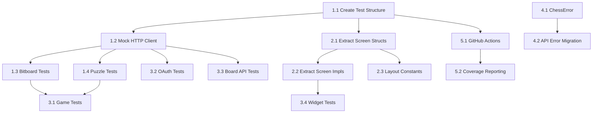

# Epic: Refactor & Unit Tests

> **Epic ID**: e01-refactor-and-tests  
> **Status**: Planned  
> **Priority**: High  
> **Created**: 2026-10-18  
> **Based on**: tech-stack.md analysis

## Overview

This epic addresses the **technical debt** and **test coverage gaps** identified in the `map-codebase` analysis. The codebase has excellent architecture but lacks automated testing and has organizational issues that will hinder maintainability as it grows.

**Goal**: Improve code organization, add comprehensive unit tests, and establish testing infrastructure for long-term maintainability.

## Background

From `specs/tech-architecture/tech-stack.md`:

- **Strengths**: Clean separation of concerns, excellent type safety, careful async handling, comprehensive Lichess integration
- **Weaknesses**: No test infrastructure, monolithic files (`models/ui.rs` at 700+ lines, `ui/screens.rs` at 1200+ lines), hardcoded dimensions
- **Existing Tests**: 5 tests in `bitboard.rs`, 4 tests in `puzzle.rs`, 1 import test in `ui/lib.rs` — total **10 tests**
- **Risk**: Lack of automated testing could lead to regressions as codebase grows

## Success Criteria

- [ ] All existing tests continue to pass
- [ ] New tests cover core logic modules (bitboard, puzzle, game, oauth)
- [ ] Screen structs extracted from monolithic `models/ui.rs`
- [ ] Screen impls extracted from monolithic `ui/screens.rs`
- [ ] Test infrastructure supports mocking HTTP clients
- [ ] `cargo test` runs successfully with expanded coverage

---

## Tasks

### Phase 1: Test Infrastructure (P0 - Foundation)

#### Task 1.1: Create Test Directory Structure
- **ID**: t01-create-test-structure
- **Priority**: P0
- **Estimate**: 1 hour
- **Description**: Create proper test directory structure
- **Acceptance Criteria**:
  - [ ] `kindle_chess/tests/` directory created
  - [ ] `tests/lib.rs` with common test utilities
  - [ ] Test helper modules for mocking
- **Files Touched**:
  - `kindle_chess/tests/lib.rs` (new)
  - `kindle_chess/tests/helpers/mod.rs` (new)

#### Task 1.2: Add Mock HTTP Client
- **ID**: t02-mock-http-client
- **Priority**: P0
- **Estimate**: 2 hours
- **Description**: Create mock implementations for reqwest client to enable API testing
- **Acceptance Criteria**:
  - [ ] `MockHttpClient` trait/object that implements same interface as reqwest
  - [ ] Ability to configure mock responses
  - [ ] Works with existing `api/` module functions
- **Files Touched**:
  - `kindle_chess/tests/helpers/mock_http.rs` (new)
  - `kindle_chess/src/api/api.rs` (modify to accept generic client)

#### Task 1.3: Expand Bitboard Tests
- **ID**: t03-bitboard-tests
- **Priority**: P0
- **Estimate**: 3 hours
- **Description**: Add comprehensive tests for bitboard module (currently 5 tests)
- **Acceptance Criteria**:
  - [ ] FEN parsing edge cases (invalid FEN, empty, malformed)
  - [ ] All piece types movement validation
  - [ ] Castling (both sides, blocked paths)
  - [ ] En passant capture
  - [ ] Promotion (all piece types)
  - [ ] Square indexing and bit manipulation
  - [ ] Starting position validation
- **Files Touched**:
  - `kindle_chess/src/models/bitboard.rs` (add tests to existing `#[cfg(test)]` module)
- **Test Count Target**: 25+ tests (from current 5)

#### Task 1.4: Expand Puzzle Tests
- **ID**: t04-puzzle-tests
- **Priority**: P0
- **Estimate**: 2 hours
- **Description**: Add comprehensive tests for puzzle module (currently 4 tests)
- **Acceptance Criteria**:
  - [ ] PuzzleSession state transitions
  - [ ] Correct move validation
  - [ ] Wrong move handling
  - [ ] Opponent reply sequencing
  - [ ] PuzzleParams cycling (difficulty, phase, color)
  - [ ] PuzzleStatus transitions
- **Files Touched**:
  - `kindle_chess/src/models/puzzle.rs` (add tests to existing `#[cfg(test)]` module)
- **Test Count Target**: 15+ tests (from current 4)

### Phase 2: Code Organization (P1 - Structural)

#### Task 2.1: Extract Screen Structs from models/ui.rs
- **ID**: t05-extract-screen-structs
- **Priority**: P1
- **Estimate**: 4 hours
- **Description**: Move Screen struct definitions to separate files
- **Acceptance Criteria**:
  - [ ] `HomeScreen` → `ui/screens/home.rs`
  - [ ] `ChessAuthScreen` → `ui/screens/chess_auth.rs`
  - [ ] `ChessGameScreen` → `ui/screens/chess_game.rs`
  - [ ] `OngoingChessGamesScreen` → `ui/screens/ongoing_games.rs`
  - [ ] `PuzzleScreen` → `ui/screens/puzzle.rs`
  - [ ] `PuzzleSettingsScreen` → `ui/screens/puzzle_settings.rs`
  - [ ] `SettingsScreen` → `ui/screens/settings.rs`
  - [ ] `UpdateScreen` → `ui/screens/update.rs`
  - [ ] `GameActionsScreen` → `ui/screens/game_actions.rs`
  - [ ] `models/ui.rs` reduced to Display, Screen trait, Transition enum only
- **Files Touched**:
  - `kindle_chess/src/models/ui.rs` (reduce from ~700 to ~100 lines)
  - `kindle_chess/src/ui/screens/home.rs` (new)
  - `kindle_chess/src/ui/screens/chess_auth.rs` (new)
  - `kindle_chess/src/ui/screens/chess_game.rs` (new)
  - `kindle_chess/src/ui/screens/ongoing_games.rs` (new)
  - `kindle_chess/src/ui/screens/puzzle.rs` (new)
  - `kindle_chess/src/ui/screens/puzzle_settings.rs` (new)
  - `kindle_chess/src/ui/screens/settings.rs` (new)
  - `kindle_chess/src/ui/screens/update.rs` (new)
  - `kindle_chess/src/ui/screens/game_actions.rs` (new)
  - `kindle_chess/src/ui/screens/mod.rs` (new - re-exports)

#### Task 2.2: Extract Screen Impls from ui/screens.rs
- **ID**: t06-extract-screen-impls
- **Priority**: P1
- **Estimate**: 6 hours
- **Description**: Move Screen trait implementations to co-located files
- **Acceptance Criteria**:
  - [ ] Each screen's `impl Screen for ...` moved to same file as struct
  - [ ] `ui/screens.rs` reduced to helper functions only (kick_auth_bootstrap, etc.)
  - [ ] All imports updated to use new module paths
  - [ ] All tests still pass
- **Files Touched**:
  - `kindle_chess/src/ui/screens.rs` (reduce from ~1200 to ~200 lines)
  - All new screen files from Task 2.1 (add impl blocks)

#### Task 2.3: Create Layout Constants Module
- **ID**: t07-layout-constants
- **Priority**: P1
- **Estimate**: 2 hours
- **Description**: Extract hardcoded dimensions to a central module
- **Acceptance Criteria**:
  - [ ] `ui/layout.rs` with display constants
  - [ ] `SCREEN_WIDTH`, `SCREEN_HEIGHT` constants
  - [ ] Button dimensions, gaps, center calculations
  - [ ] All screens use constants instead of magic numbers
- **Files Touched**:
  - `kindle_chess/src/ui/layout.rs` (new)
  - All screen files (update to use constants)
  - `kindle_chess/src/ui/widgets/board.rs` (update to use constants)

### Phase 3: Additional Test Coverage (P1 - Quality)

#### Task 3.1: Add Game Module Tests
- **ID**: t08-game-tests
- **Priority**: P1
- **Estimate**: 2 hours
- **Description**: Add tests for game-related types and logic
- **Acceptance Criteria**:
  - [ ] `GameData` parsing from JSON
  - [ ] `GameDataList` handling
  - [ ] `StreamEvent` parsing
  - [ ] `Turn` enum state transitions
  - [ ] `PlayedBy` type validation
- **Files Touched**:
  - `kindle_chess/src/models/game.rs` (add `#[cfg(test)]` module)
- **Test Count Target**: 10+ tests

#### Task 3.2: Add OAuth Module Tests
- **ID**: t09-oauth-tests
- **Priority**: P1
- **Estimate**: 3 hours
- **Description**: Add tests for OAuth flow components
- **Acceptance Criteria**:
  - [ ] `TokenInfo` serialization/deserialization
  - [ ] `LichessUser` parsing
  - [ ] `AuthConfig` validation
  - [ ] `AuthState` transitions
  - [ ] PKCE code challenge generation (with mock)
- **Files Touched**:
  - `kindle_chess/src/models/oauth.rs` (add `#[cfg(test)]` module)
  - `kindle_chess/src/api/oauth.rs` (add tests with mock HTTP client)
- **Test Count Target**: 12+ tests

#### Task 3.3: Add Board API Tests
- **ID**: t10-board-api-tests
- **Priority**: P1
- **Estimate**: 3 hours
- **Description**: Add tests for board API module
- **Acceptance Criteria**:
  - [ ] `BoardAPI<Idle>` construction
  - [ ] `BoardAPI<InGame>` state transitions
  - [ ] Typestate enforcement (compiler prevents invalid calls)
  - [ ] Game data fetching (with mock)
  - [ ] Move submission (with mock)
- **Files Touched**:
  - `kindle_chess/src/models/board_api.rs` (add `#[cfg(test)]` module)
  - `kindle_chess/src/api/board.rs` (add tests with mock HTTP client)
- **Test Count Target**: 10+ tests

#### Task 3.4: Add Widget Tests
- **ID**: t11-widget-tests
- **Priority**: P1
- **Estimate**: 3 hours
- **Description**: Add tests for UI widgets (pure logic, not rendering)
- **Acceptance Criteria**:
  - [ ] `Button` hit detection
  - [ ] `IconButton` hit detection
  - [ ] `Rectangle` contains/overlaps logic
  - [ ] `Square` parsing and formatting
  - [ ] Board coordinate calculations
- **Files Touched**:
  - `kindle_chess/src/ui/widgets/button.rs` (add `#[cfg(test)]` module)
  - `kindle_chess/src/ui/widgets/icon_button.rs` (add `#[cfg(test)]` module)
  - `kindle_chess/src/ui/events.rs` (add `#[cfg(test)]` module for Rectangle/Square)
- **Test Count Target**: 15+ tests

### Phase 4: Error Handling Improvements (P2 - Robustness)

#### Task 4.1: Create ChessError Enum
- **ID**: t12-chess-error-type
- **Priority**: P2
- **Estimate**: 3 hours
- **Description**: Define a consistent error type for the application
- **Acceptance Criteria**:
  - [ ] `ChessError` enum with all error variants
  - [ ] Implements `std::error::Error + Send + Sync + 'static`
  - [ ] `From<Box<dyn Error>>` implementation
  - [ ] `From` implementations for common error types (reqwest, serde_json, etc.)
  - [ ] Used in at least 3 modules as proof of concept
- **Files Touched**:
  - `kindle_chess/src/error.rs` (new)
  - `kindle_chess/src/models/mod.rs` (re-export)
  - Selected modules for proof of concept

#### Task 4.2: Migrate API Module to ChessError
- **ID**: t13-api-error-migration
- **Priority**: P2
- **Estimate**: 2 hours
- **Description**: Update API module to use ChessError
- **Acceptance Criteria**:
  - [ ] All `api/` functions return `Result<T, ChessError>`
  - [ ] All async boundaries handle errors consistently
  - [ ] All existing functionality preserved
- **Files Touched**:
  - `kindle_chess/src/api/api.rs`
  - `kindle_chess/src/api/board.rs`
  - `kindle_chess/src/api/oauth.rs`
  - `kindle_chess/src/api/update.rs`
  - `kindle_chess/src/api/github.rs`

### Phase 5: Continuous Integration (P2 - Automation)

#### Task 5.1: Add GitHub Actions Workflow
- **ID**: t14-github-actions
- **Priority**: P2
- **Estimate**: 2 hours
- **Description**: Set up CI pipeline for automated testing
- **Acceptance Criteria**:
  - [ ] `.github/workflows/test.yml` created
  - [ ] Runs on push to main and PRs
  - [ ] Runs `cargo test`
  - [ ] Runs `cargo clippy`
  - [ ] Runs `cargo fmt --check`
  - [ ] Caches dependencies for faster runs
- **Files Touched**:
  - `.github/workflows/test.yml` (new)

#### Task 5.2: Add Test Coverage Reporting
- **ID**: t15-coverage-reporting
- **Priority**: P2
- **Estimate**: 2 hours
- **Description**: Add coverage reporting to CI
- **Acceptance Criteria**:
  - [ ] `cargo-tarpaulin` or `cargo-llvm-cov` configured
  - [ ] Coverage threshold set (start at 20% to pass initially)
  - [ ] Coverage report uploaded as artifact
  - [ ] Coverage badge in README
- **Files Touched**:
  - `.github/workflows/test.yml` (update)
  - `README.md` (add badge)

---

## Task Dependencies

---

## Estimates Summary

| Phase | Tasks | Estimate | Priority |
|-------|-------|----------|----------|
| Phase 1: Test Infrastructure | 4 | 8 hours | P0 |
| Phase 2: Code Organization | 3 | 12 hours | P1 |
| Phase 3: Test Coverage | 4 | 10 hours | P1 |
| Phase 4: Error Handling | 2 | 5 hours | P2 |
| Phase 5: CI | 2 | 4 hours | P2 |
| **Total** | **15** | **~39 hours** | - |

---

## Test Coverage Targets

### Current State
- `bitboard.rs`: 5 tests
- `puzzle.rs`: 4 tests  
- `ui/lib.rs`: 1 test
- **Total**: 10 tests

### Target State (End of Epic)
- `bitboard.rs`: 25+ tests
- `puzzle.rs`: 15+ tests
- `game.rs`: 10+ tests
- `oauth.rs` (models + api): 12+ tests
- `board_api.rs` (models + api): 10+ tests
- `widgets/`: 15+ tests
- `events.rs`: 5+ tests
- **Total**: **92+ tests**

### Coverage Goals
- **Initial**: ~20% (to pass CI gate)
- **Phase 1 Target**: ~40%
- **Phase 3 Target**: ~60%
- **Final Target**: ~75%

---

## Risk Assessment

### Low Risk
- Task 1.1, 1.2: New files, no existing code changes
- Task 3.1-3.4: Adding tests to existing modules, additive only
- Task 5.1, 5.2: CI configuration, no code changes

### Medium Risk
- Task 2.1, 2.2: File reorganization, requires careful import updates
- Task 4.1, 4.2: Error type changes, affects function signatures

### Mitigation Strategies
1. **Incremental Changes**: Commit after each task, ensure tests pass
2. **Feature Flags**: Use `#[cfg(test)]` for new test code, no runtime impact
3. **Backward Compatibility**: Keep old error handling paths during migration
4. **Code Review**: Each phase gets reviewed before merging

---

## Definition of Done

For each task:
- [ ] Code compiles without warnings
- [ ] All existing tests pass
- [ ] New tests pass
- [ ] Code formatted with `cargo fmt`
- [ ] No clippy warnings (`cargo clippy -- -D warnings`)
- [ ] Documentation updated (if applicable)
- [ ] Commit message follows Conventional Commits

For the epic:
- [ ] All 15 tasks completed
- [ ] Test count >= 92
- [ ] Coverage >= 60%
- [ ] CI pipeline green
- [ ] No regressions in existing functionality

---

## Next Steps

1. **Start with Phase 1**: Test infrastructure is foundation for everything else
2. **Parallelize where possible**: Tasks within same phase can be worked in parallel
3. **Review after Phase 1**: Assess test infrastructure before moving to organization changes
4. **Review after Phase 3**: Assess coverage before moving to error handling changes

---

## Related Documents

- `specs/tech-architecture/tech-stack.md` — Source analysis and recommendations
- `CLAUDE.md` — Project overview and conventions
- `kindle_chess/Cargo.toml` — Dependency management
